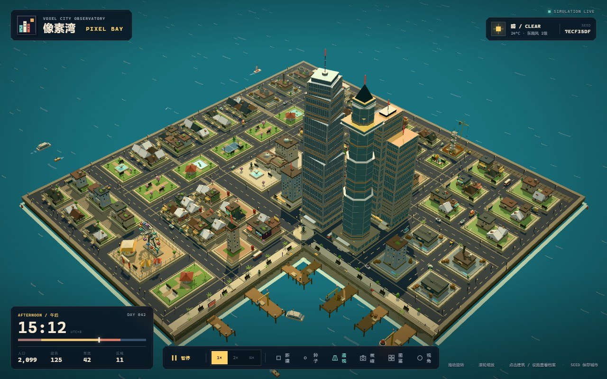
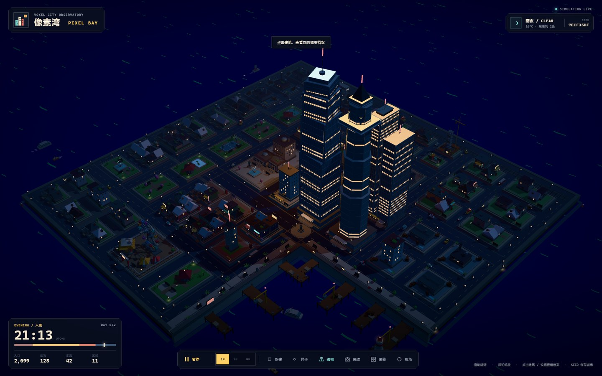
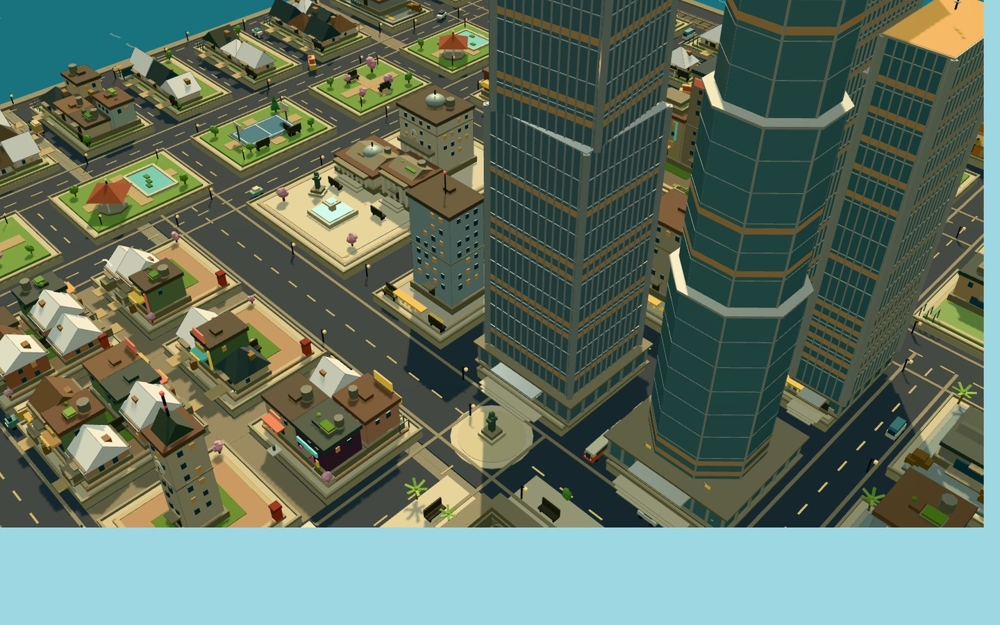

<div align="center">

# 像素湾 · PIXEL BAY

**用 Three.js 写的一座可交互像素风城市：种子决定城市，图鉴定义零件，组合层拼出街区。**

城市观测站 · 城市物体图鉴 · 组合层

[**MIT License**](./LICENSE) · Copyright (c) 2026 tobi



</div>

---

## 目录

- [这是什么](#这是什么)
- [快速开始](#快速开始)
- [三个页面](#三个页面)
  - [城市观测站](#城市观测站-indexhtml)
  - [城市物体图鉴](#城市物体图鉴-cataloghtml)
  - [组合层](#组合层-compositionshtml)
- [交互、快捷键与 URL 参数](#交互快捷键与-url-参数)
- [技术架构](#技术架构)
- [目录结构](#目录结构)
- [离线工具链](#离线工具链)
- [多 Agent 接入](#多-agent-接入)
- [性能与已知限制](#性能与已知限制)
- [文档索引](#文档索引)
- [开发约定](#开发约定)
- [许可](#许可)

## 这是什么

像素湾（PIXEL BAY）是一个跑在浏览器里的像素风三维城市玩具，由三个页面组成：

| 页面 | 入口 | 一句话 |
| --- | --- | --- |
| 城市观测站 | `index.html` | 一座会昼夜循环、可旋转缩放、可点开建筑档案的活城市 |
| 城市物体图鉴 | `catalog.html` | 构成这座城市的 188 件物体档案，每件都有原版与第二版两种造型 |
| 组合层 | `compositions.html` | 把图鉴物体按地块组合成庭院、步行街、广场、工地等街区原型 |

几条贯穿全项目的规则：

- **种子驱动**：一个 8 位十六进制种子决定整座城市（街区、路网、建筑、车流、船只）。同一个种子永远生成同一座城市。
- **图鉴优先**：城市里出现的每一件建筑、道具、载具，都必须在图鉴里登记过（见 `AGENTS.md`）。图鉴是资产清单，城市只是它的一个消费者。
- **纯程序化 + 共享几何体**：没有外部模型文件，全部由代码用少量基础几何体拼出来；材质按「颜色 + 参数」缓存复用。
- **零框架**：纯 ESM + Vite，没有 UI 框架，样式为手写 CSS。
- **可被多 Agent 接入**：规划 / 数据 / 建模 / 渲染分层解耦，城市是种子的纯函数；另提供 JSON 世界快照与离线校验工具，方便外部程序或多个 Agent 协作（见 [多 Agent 接入](#多-agent-接入)）。

技术栈：**Three.js 0.186** · **Vite 8** · 原生 ES Modules · 手写 CSS。

## 快速开始

### 环境要求

- **Node.js `^20.19.0` 或 `>=22.12.0`**（Vite 8 的要求）
- 支持 **WebGL2** 的现代浏览器（Chrome / Edge / Firefox / Safari 新版）

### 安装与运行

```bash
npm install
npm run dev
```

打开 <http://127.0.0.1:5173/> 即可进入城市观测站。

### 可用脚本

| 命令 | 作用 |
| --- | --- |
| `npm run dev` | 启动开发服务器（`vite --host 127.0.0.1`，默认 5173 端口） |
| `npm run build` | 生产构建到 `dist/`，包含 `index.html`、`catalog.html`、`compositions.html` 三个入口 |
| `npm run preview` | 预览构建产物（`vite preview`，默认 4173 端口） |

> 三个页面在开发服务器下都能直接访问：`/`、`/catalog.html`、`/compositions.html`。

## 三个页面

### 城市观测站（`index.html`）


一座 59 个街区、120 多栋建筑、11 个功能区的岛城。默认种子 `7ECF35DF` 的规模是 **125 栋建筑 / 42 辆车 / 6 艘船 / 2,099 位居民**，功能区包括中央商务区、老城街区、滨水港区、创意街区、花园住宅区、市政广场区、学院区、工业区、中央绿轴、商业街区与游乐区。

- **交互**：左键拖动旋转、滚轮缩放（缩放指向光标）、点击建筑或设施打开「城市档案」（名称、类型、层数、高度、人口、年份、入住率等），闲置 22 秒后自动巡游。
- **模拟**：24 小时昼夜循环，7 个时段（深夜 / 黎明 / 早晨 / 正午 / 午后 / 黄昏 / 入夜）。太阳角度、天空、雾、水色、窗灯、路灯、霓虹与摩天楼信标都随时间变化；车流沿环形道路行驶，船只在港湾巡游。
- **相机**：等轴（orthographic）与透视（perspective）两种投影一键切换，缩放范围 0.68×–2.6×。
- **工具条**：暂停 / 继续、1× / 2× / 4× 模拟速度、重新生成城市、种子库、投影切换、微缩摄影、复位视角。
- **种子**：种子会写入地址栏并记忆在 `localStorage`，可以复制种子或分享带种子的链接。

夜间：



靠近看细节（透视 + 最大缩放下的街区）：



### 城市物体图鉴（`catalog.html`）


- **188 件物体 / 9 个分组**：建筑 62、摩天大楼 26、建筑工地 14、公园 14、游乐设施 10、载具 16、街道设施 20、植被与生态 14、滨水物体 12。
- **两版造型**：每件物体都有原版（`· 1`）与重新设计的第二版（`· 2`），第二版规格集中在 `src/catalog-variants/`；城市本身仍然使用原版模型。
- **缩略图**：共享一个离屏 WebGL 渲染器，按 `192×144` 逐张生成像素缩略图。
- **检视台**：点击卡片打开检视台，可拖拽旋转查看模型，并附有尺寸、类别、标签与说明。
- **筛选**：按分组筛选，建筑还可按家族（住宅 / 商业 / 商务 / 公共 / 工业 / 休闲 / 地标）筛选。
- **深链接**：`/catalog.html?asset=b-townhouse` 可以直接打开某件物体的检视台。

摩天大楼按真实地标的高度与体量分段重制（13 座，含 7 座真实地标 + 6 座原创塔楼），建模方法与对照表见 [`docs/skyscrapers/README.md`](./docs/skyscrapers/README.md)：


### 组合层（`compositions.html`）


图鉴收录「单件物体」，组合层把多件物体按地块组织成「街区原型」，是从物体到城市的中间层。

- **10 类组合原型**：居民区、围合居民区、围合庭院、步行街墙、塔楼广场、市场巷、学院院落、建造工地、口袋绿轴、节庆场。
- **三层栈**：物体层 → 组合层 → 城市层（页面右侧有说明）。
- **硬规则**：组合内部只使用图鉴里的静态物体；**不出现任何载具**；建筑正放（不旋转）、不缩放，只有街道设施与植被按真实比例缩小。
- **种子与重掷**：每次生成由种子决定，同种子同组合；可以「全部重掷」，也可以只重掷某一个组合。分享链接会带上种子与各组合的重掷次数。
- **详情**：组合卡片可打开弹窗，查看元素清单、地块尺寸、规则说明与生成参数。

## 交互、快捷键与 URL 参数

### 键盘快捷键（城市观测站）

| 按键 | 作用 |
| --- | --- |
| `空格` | 暂停 / 继续模拟 |
| `R` | 重新生成城市（随机种子） |
| `C` | 复位摄像机视角 |
| `M` | 开关微缩摄影效果 |
| `1` / `2` / `4` | 切换模拟速度 |
| `Esc` | 关闭种子面板 / 取消选中 |

### URL 参数

| 页面 | 参数 | 取值 | 说明 |
| --- | --- | --- | --- |
| 城市 | `seed` | 1–8 位十六进制 | 城市种子，例如 `7ECF35DF` |
| 城市 | `projection` | `persp` / `ortho` | 初始投影 |
| 城市 | `hour` | `0`–`24` | 初始时刻（默认 15.2） |
| 城市 | `miniature` | `1` / `true` | 开启微缩摄影后处理 |
| 图鉴 | `asset` | 物体 id | 直接打开某件物体的检视台，例如 `b-townhouse` |
| 组合层 | `seed` | 十六进制 | 组合生成种子 |
| 组合层 | `rolls` | 逗号分隔的整数 | 各组合的重掷次数 |

示例：

```
http://127.0.0.1:5173/?seed=7ECF35DF&projection=persp&hour=21.2
http://127.0.0.1:5173/catalog.html?asset=s-taipei
http://127.0.0.1:5173/compositions.html?seed=88F59A3F
```

种子与投影会记忆在 `localStorage`（`pixelbay.seed` / `pixelbay.projection`），并同步到地址栏，方便直接分享当前城市。

## 技术架构

### 分层

```
城市观测站  index.html
├─ src/main.js                页面装配：渲染器 / 相机 / 灯光 / HUD / 交互 / 主循环
├─ src/city.js                程序化建城：街区、建筑、街道设施、车船、昼夜联动
│   ├─ src/city-plan.js       规划层：只输出地块、路网、栈桥、滨水步道（纯数据）
│   └─ src/object-catalog.js  图鉴数据：建筑 / 塔楼 / 载具 / 街道 / 植被 / 滨水
├─ src/environment.js         24 小时环境采样：天空、雾、阳光、水色、灯光强度
└─ src/miniature.js           微缩摄影后处理：tilt-shift + 调色 + FXAA

城市物体图鉴  catalog.html
├─ src/catalog-page.js        列表、筛选、加载进度、检视台装配
├─ src/showcase-studio.js     缩略图与检视台（共享离屏渲染器）
└─ src/showcase-models.js     图鉴模型的共享构建器（两版造型共用）

组合层  compositions.html
├─ src/compositions-page.js   画廊、弹窗、分享链接
├─ src/composition-catalog.js 纯数据组合生成（种子 → 布局，不依赖 Three.js）
├─ src/composition-models.js  组合建模（按真实包围盒排布）
└─ src/composition-studio.js  组合缩略图渲染
```

城市页与图鉴页共享 `src/object-catalog.js` 与 `src/showcase-models.js`：前者是「城市里有什么」，后者是「它们长什么样」。

### 渲染管线

- **渲染器**：`WebGLRenderer`（antialias），像素比上限 2，总渲染像素上限 240 万；`NeutralToneMapping`，曝光 1.28，sRGB 输出。
- **灯光**：半球光 + 环境光 + 平行光（2048² `PCFSoftShadowMap`，±35 阴影相机）+ 补光 + 夜间城市点光；强度与颜色全部来自 `environment.js` 的时间采样。
- **天空与雾**：自定义天空球 shader（天顶 / 地平线渐变）+ 线性雾，雾距随相机距离缩放，近景不糊、远景不脏。
- **实例化**：4 个 `InstancedMesh` 承担高频重复件——铁轨枕木、路面标线、暗窗、亮窗（默认种子约 1,835 个实例）。
- **几何与材质**：12 种共享几何体（盒、四坡顶、山墙顶、圆柱、圆塔、圆锥、半球、二十面体、平面及三种描边几何体）；材质按「颜色 + 参数」缓存复用，默认种子约 310 个材质。
- **描边**：建筑轮廓用 `LineSegments` + 半透明描边材质，`renderOrder` 高于实体，保持像素画的硬边轮廓。
- **微缩摄影（可选）**：场景先渲染到 HDR 缓冲，经可分离 tilt-shift 模糊（屏幕空间弥散圆）→ `OutputPass` 恢复色调映射 → 调色（饱和度 / 对比 / 暗角 / 色差 / 颗粒）→ FXAA。

### 确定性

- 城市使用 `mulberry32(seed)` 作为唯一随机源：`createCityPlan(rng)` 先排出街区与路网，再按街区放置建筑、道具与绿化。
- 同一 `seed` 生成完全相同的城市（`docs/review/metrics.mjs` 内含确定性断言，跨 5 个种子校验建筑数与网格数）。
- 图鉴模型使用「内容哈希」作为随机种子，保证同一件物体的缩略图与检视台造型稳定。

## 目录结构

```
pixel-bay/
├─ index.html                  城市观测站
├─ catalog.html                城市物体图鉴
├─ compositions.html           组合层
├─ vite.config.js              三个入口的构建配置
├─ AGENTS.md                   项目规则：城市元素必须来自图鉴
├─ src/
│  ├─ main.js                  城市页装配与主循环
│  ├─ city.js                  程序化城市生成（街区 / 建筑 / 车船 / 街道设施）
│  ├─ city-plan.js             正交网格规划（纯数据）
│  ├─ object-catalog.js        图鉴数据与两版配对
│  ├─ catalog-variants/        第二版造型规格（建筑 / 塔楼 / 休闲 / 街道）
│  ├─ showcase-models.js       图鉴模型共享构建器
│  ├─ showcase-studio.js       缩略图与检视台渲染
│  ├─ catalog-page.js          图鉴页逻辑
│  ├─ composition-catalog.js   组合层数据与生成（纯数据）
│  ├─ composition-models.js    组合层建模
│  ├─ composition-studio.js    组合层缩略图渲染
│  ├─ compositions-page.js     组合层页面逻辑
│  ├─ environment.js           24 小时环境采样
│  ├─ miniature.js             微缩摄影后处理
│  ├─ style.css / catalog.css / compositions.css
│  └─ ...
├─ docs/
│  ├─ planning/                规划调研、审计工具、离线渲染器、改版说明
│  ├─ review/                  内容 / 工程 / 运行时审计与提升建议
│  ├─ skyscrapers/             摩天大楼重制说明与对照图
│  ├─ miniature-study/         微缩摄影后处理研究
│  ├─ compositions/            组合层预览图
│  └─ screenshots/             README 截图
├─ harbor-study/               早期港口布局研究快照（历史）
└─ ring-study/                 早期环形布局研究快照（历史）
```

## 离线工具链

项目里有几个**只读**的 Node 脚本，用来在没有浏览器的环境里检查城市、规划与图鉴模型。

之所以需要它们：开发沙箱禁止 Chromium 的命名管道 IPC，无头 WebGL 截图不可用；而 `src/city.js` 只在生成光晕贴图时接触 DOM，因此在 Node 里用一个 2D canvas stub 就能构建整座城市，再用软件光栅化器出图。

| 命令 | 作用 |
| --- | --- |
| `node docs/planning/city-smoke.mjs` | 8 个种子的建城冒烟测试（非有限变换、建筑/街区数量下限） |
| `node docs/planning/render-city.mjs --view hero --out docs/planning/render-hero.png` | 整城软件渲染，支持 `hero` / `iso` / `top`，可加 `--seed` `--crop` `--scale` `--src` |
| `node docs/planning/plan-check.mjs` | 规划结构审计（街区 × 路网 / 越界 / 悬空端点）并输出俯视预览图 |
| `node docs/planning/audit.mjs` | 只读生成器审计，结果写入 `docs/planning/audit-results.json` |
| `node docs/planning/export-city.mjs --seed 7ECF35DF` | 导出该种子的稳定 JSON 世界快照（`--out` `--compact` 可选），供外部程序 / Agent 消费 |
| `node docs/review/metrics.mjs` | 网格 / 材质 / draw call / 实例数 / 确定性指标 |
| `node --expose-gc docs/review/runtime-probe.mjs` | raycast 开销、`dispose()` 完整性、连续重建的内存增长 |
| `node docs/skyscrapers/render.mjs --group skyscrapers` | 图鉴模型离线渲染（`--ids` `--view` `--scale` 可选） |
| `python docs/skyscrapers/compose.py` | 把塔楼渲染图拼成带标注的对照表 |
| `python docs/miniature-study/make-preview.py` | 微缩摄影效果的静态预览 |

这些脚本只读取应用源码、只往 `docs/` 里写产物，不会改动 `src/`。

## 多 Agent 接入

（Multi-Agent Integration）

仓库本身不含 Agent 运行时，但它的分层是**为外部程序 / 多个 Agent 协作设计的**：规划、数据、建模、渲染彼此解耦，城市是种子的纯函数，关键产物都能在 Node 里离线生成与校验。因此可以把它当作多 Agent 系统的「共享世界」——不同 Agent 负责不同层，用种子对齐世界状态，用离线工具互相验收。

### 已具备的接入面

| 接入点 | 位置 | 说明 |
| --- | --- | --- |
| 纯数据规划层 | `src/city-plan.js` → `createCityPlan(rng)` | 只返回街区、路网、栈桥、步道等纯数据，不依赖 Three.js，可直接生成或替换规划 |
| 城市构建 API | `src/city.js` → `createCity({ seed })` | 返回 `group`（Three.js 场景）、`buildings`（id / 名称 / 类型 / 坐标 / 高度 / 人口 / 边界）、`cars` / `boats` / `blocks`、`stats`，以及 `update` / `updateEnvironment` / `dispose` |
| 图鉴数据 | `src/object-catalog.js` | `ASSETS` / `ASSET_BY_ID` / `BUILDINGS_BY_ID` 等 Map，可按 id 查询，也可用来校验「城市元素必须来自图鉴」 |
| 组合层生成 | `src/composition-catalog.js` → `generateComposition` | 纯数据组合计划（种子 → 布局），可被读取或替换 |
| 世界状态标识 | URL `?seed=<hex>&projection=&hour=` | 一个种子 = 一座可分享、可复现的城市，Agent 之间用它对齐上下文 |
| 离线校验 | `docs/planning/*.mjs`、`docs/review/*.mjs` | 无浏览器也能建城、审计规划、出图、量指标 |
| 结构化快照 | `docs/planning/export-city.mjs` → `city-<SEED>.json` | 种子 → 稳定 JSON（统计、功能区、街区、建筑、车船、图鉴摘要），可 diff、可跨语言消费 |

### 三种接入方式

**1. 直接 import（Node / 构建期）** —— 与仓库里的工具脚本同一套做法：

```js
// agent.mjs
const ctx2d = { fillStyle: null, createRadialGradient: () => ({ addColorStop() {} }), fillRect() {} };
globalThis.document = { createElement: () => ({ width: 64, height: 64, style: {}, getContext: () => ctx2d }) };

const { createCity } = await import("./src/city.js");
const city = createCity({ seed: 0x7ECF35DF });
console.log(city.stats);              // { buildings, cars, boats, districts, population, jobs, parks }
console.log(city.buildings[0].name);  // 建筑记录：id / 坐标 / 高度 / 人口 / 所属功能区…
city.dispose();
```

**2. JSON 快照（跨进程 / 跨语言）**：

```bash
node docs/planning/export-city.mjs --seed 7ECF35DF
# → docs/planning/city-7ECF35DF.json（--out 可改路径，--compact 输出单行）
```

输出固定 schema（`schema: 1`）：`seed` / `stats` / `districts` / `blocks` / `buildings` / `vehicles` / `catalog`。同一 seed 两次导出**字节一致**（无时间戳），适合 Agent 之间做 diff 与回归断言；`--compact` 可输出单行 JSON。

**3. URL 契约（人与 Agent 共享）**：把 `?seed=…` 链接交给另一个 Agent 或人，打开就是同一座城市；图鉴用 `?asset=`，组合层用 `?seed=&rolls=`。

### 协作模式建议

- **按层分工**：规划 Agent（`city-plan.js`）/ 建筑与道具 Agent（`city.js`）/ 图鉴与模型 Agent（`object-catalog.js` + `showcase-models.js`）/ 组合 Agent（`composition-*.js`）——各改各的层，改动面不重叠。
- **种子对齐**：把种子当作世界 ID，任何「我们看的是不是同一座城」的问题都用种子回答。
- **门禁自检**：每个 Agent 提交前跑 `node docs/planning/city-smoke.mjs` + `npm run build`；动规划再加 `plan-check.mjs`，动性能相关再加 `metrics.mjs`。
- **共享约束**：`AGENTS.md` 的「城市元素必须来自图鉴」是所有 Agent 的硬约束——新元素先登记图鉴，再被城市消费。
- **可复现对比**：用 `export-city.mjs` 导出改前 / 改后的快照做结构化 diff，比截图对比更适合自动判定。

### 当前边界

- 仓库**不包含** Agent 运行时、消息总线或网络 API；多 Agent 的编排在仓库之外（由宿主系统负责），这里提供的是**数据契约、确定性复现与离线验证**。
- 运行时实时改造城市（Agent 在线增删街区）需要额外加一层「命令 → 重建」接口；现有架构下最省事的做法是「Agent 产出种子 / 规划数据 → 重新 `createCity`」。

## 性能与已知限制

`docs/review/metrics.mjs` 在 Node 侧对 5 个种子的实测（浏览器端会叠加 GPU 渲染开销）：

| 指标 | 数值 |
| --- | --- |
| 建城耗时（Node 构建场景图） | 35–77 ms |
| 建筑数量 | 121–129 |
| Mesh | 约 6.0k–6.5k |
| InstancedMesh / 实例 | 4 / 约 1.8k |
| LineSegments（描边） | 约 215 |
| 三角形 | 约 102k–109k |
| 主渲染 draw call | 约 6.3k / 帧 |
| 阴影 pass draw call | 约 4.4k / 帧 |
| 共享几何体 / 材质 | 12 / 约 310 |

已知限制与后续方向：

- **静态几何尚未合批**：draw call 仍在数千量级，阴影贴图默认每帧重绘；合批是收益最大的优化项。
- **图鉴缩略图运行时生成**：188 张 `192×144` 缩略图在浏览器里串行生成，低端设备首屏较慢，预渲染成静态资源可以显著改善。
- **无自动化测试框架**：目前只有冒烟脚本与审计脚本兜底。
- **移动端未做画质分级**：没有自适应分辨率与 WebGL 上下文丢失恢复。
- 更完整的审计结论与优先级建议（P0 / P1 / P2）见 [`docs/review/improvement-report-2026-10-24.md`](./docs/review/improvement-report-2026-10-24.md)。

## 文档索引

| 路径 | 内容 |
| --- | --- |
| [`docs/planning/rectilinear-plan-2026-10-24.md`](./docs/planning/rectilinear-plan-2026-10-24.md) | 正交网格规划改版说明（含改版前后真实截图与平面图） |
| [`docs/planning/城市规划调研与改进方案.md`](./docs/planning/城市规划调研与改进方案.md) | 城市为何看起来杂乱：问题定位与推荐结构 |
| [`docs/review/improvement-report-2026-10-24.md`](./docs/review/improvement-report-2026-10-24.md) | 综合审计：性能、架构、内容与交付建议 |
| [`docs/review/notes-engineering.md`](./docs/review/notes-engineering.md) 等 | 工程 / 内容 / 运行时专项笔记 |
| [`docs/skyscrapers/README.md`](./docs/skyscrapers/README.md) | 13 座摩天大楼按真实地标重制的方法与对照 |
| [`docs/miniature-study/`](./docs/miniature-study/) | 微缩摄影后处理的静态研究 |
| `harbor-study/`、`ring-study/` | 早期港口与环形布局研究快照（历史归档） |

## 开发约定

- **图鉴优先**（`AGENTS.md`）：城市里放置的所有建筑物和物品、交通工具，所有元素都应当是图鉴里有的。新增城市元素时，先在 `src/object-catalog.js` 登记，再在 `src/city.js` 里消费。
- **纯 ESM、无框架**：页面逻辑、渲染逻辑、数据都在 `src/*.js` 里，没有打包期魔法；样式为手写 CSS。
- **数据与建模分离**：`city-plan.js` 与 `composition-catalog.js` 只产出纯数据，建模在 `city.js` / `composition-models.js` 完成，便于离线审计与复用。
- **改完请跑一遍**：`node docs/planning/city-smoke.mjs`（建城不崩）、`npm run build`（三个入口可构建）；改到图鉴/组合层时再跑一次 `docs/review/metrics.mjs` 看指标变化。
- **提交信息**：使用 `feat(scope):` / `fix(scope):` / `docs:` / `chore:` 前缀，一次提交只做一件事。

## 许可

本项目基于 [MIT 许可证](./LICENSE) 开源。

```
Copyright (c) 2026 tobi <qiaoyuangcd@gmail.com>
```

你可以自由地使用、复制、修改、合并、发布、分发、再授权和/或销售本软件的副本，唯一的要求是：在所有副本或实质性部分中保留上述版权声明与许可声明。本软件按「原样」提供，不附带任何明示或暗示的担保。

第三方依赖：[Three.js](https://threejs.org/)（MIT）、[Vite](https://vite.dev/)（MIT）。

