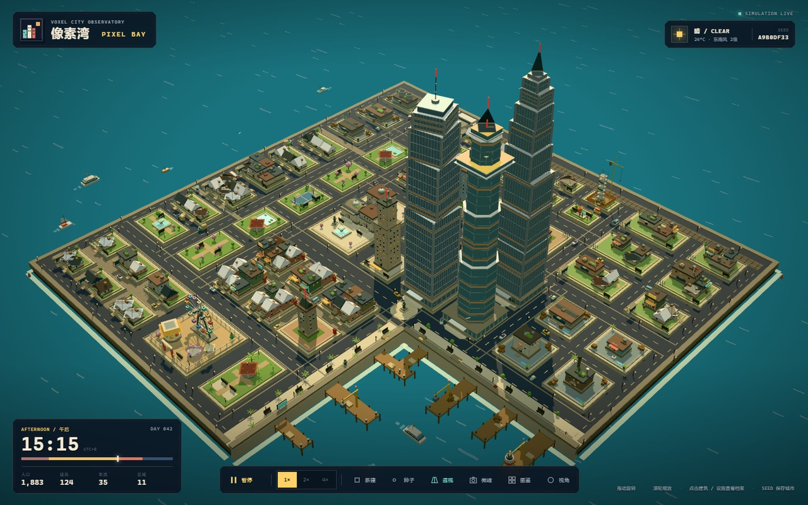
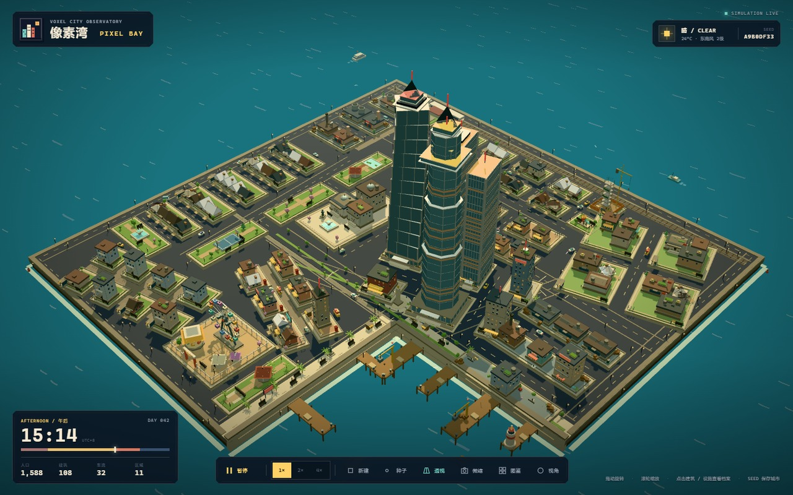

# 像素湾：横平竖直的城市规划（2026-10-24）

本轮把首页城市从“多片区各自旋转的有机网格”改回**全正交地块 + 清晰分区**的规划，同时保留海湾、铁路、码头、功能分区与全部图鉴建筑。

- 规划数据：`src/city-plan.js`（重写）
- 渲染接入：`src/city.js`（局部修改，见第 5 节）
- 验证工具：`docs/planning/plan-check.mjs`、`docs/planning/render-city.mjs`



## 1. 规划原则

1. **所有元素平行于世界 X/Z 轴**：街区 `angle` 恒为 0，道路只使用水平/垂直线段，码头沿湾岸正交伸出，铁路保持东西走向。
2. **片区是可建矩形，街道是矩形之间的走廊**：每个片区（zone）给定一个矩形与网格参数（列数、行数、内部街道宽度），街区把矩形**恰好填满**；片区之间留出 2.0–2.7 的主干道走廊，因此分区边界天然就是街道。
3. **不越界**：`layoutZone` 按“总宽 = 街区宽之和 + 内部街道宽之和”反解街区尺寸，街区不再旋转、不再裁切，也不可能越出片区或陆地。
4. **保留原有功能结构**：中心商务区仍在湾角，老城隔湾相望，港区在东岸，工业与车站在铁路一侧，学院在东北，住宅成环，绿轴纵贯西侧，游乐场与滨水公园在南岸。

## 2. 主骨架

- 海岸路：西 `x=-22.4`、南 `z=22.4`、东 `x=22.4`（北岸由铁路占据）。
- 东西向：`z=-14.2`（北带）、`z=-7.0`（中带）、`z=4.4` 滨水大道（宽 2.2）、`z=14.6`（南带）。
- 南北向：`x=-15.8`、`x=-10.4`、`x=-3.1`、`x=9.4`、`x=11.8`、`x=4.4`（西湾岸码头路，宽 2.2）。
- 支路连接：车站巷、工业—住宅巷、郊区两条纵巷。
- 17 条主干道构成**单一连通网络**（改版前为 3 个不连通分量）。

## 3. 分区表

矩形为 `[x0, x1, z0, z1]`，`cols × rows` 为片区内街区网格，`street` 为片区内街道宽度，`morph` 决定建筑落位模板。

| 片区 | 矩形 | 网格 | 内部街宽 | morph | 角色 |
| --- | --- | --- | --- | --- | --- |
| downtown 中心商务区 | -2.35, 10.85, -5.85, 3.05 | 3×2 | 1.6 | tower | 地标 + 2 座摩天楼 + 3 座办公楼 |
| oldtown 老城 | -9.45, 3.05, 5.75, 13.55 | 3×2 | 0.8 | row | 钟楼、创意街区 |
| civic 市政广场 | -9.45, -3.85, -5.85, 3.05 | 1×1 | — | civic | 市政厅、博物馆、图书馆、喷泉广场 |
| commercial 商业街 | -9.45, 8.45, -13.05, -8.15 | 3×1 | 1.25 | perimeter | 市场、百货、沿街商铺 |
| resA 西侧住宅 | -21.55, -16.75, -8.75, 13.55 | 1×6 | 1.1 | perimeter | 联排住宅、邻里公园 |
| parkwest 绿轴 | -14.85, -11.35, -13.05, 13.55 | 1×5 | 1.2 | green | 水池/樱花/运动 5 座带状公园 |
| resB 北侧住宅 | -10.45, 8.45, -20.5, -15.35 | 5×2 | 1.05 | row | 背靠铁路的联排、建设工地、儿童公园 |
| academic 学院 | 10.35, 21.55, -20.5, -8.15 | 2×3 | 1.35 | campus | 学校、校园绿地、宿舍 |
| industrial 工业 | -21.55, -16.75, -20.5, -10.05 | 1×3 | 1.5 | warehouse | 能源站、仓库、工坊 |
| station 车站 | -14.85, -11.75, -20.5, -15.35 | 1×1 | — | station | 像素湾站 |
| port 港区 | 12.75, 21.55, -5.85, 3.05 | 2×2 | 1.35 | warehouse | 保税仓库、堆场、港务办公室 |
| suburb 郊区 | -21.55, -9.15, 15.65, 21.55 | 3×2 | 1.0 | row | 坡顶小屋与庭院住宅 |
| amusement 游乐场 | -7.65, -1.75, 15.65, 21.55 | 1×1 | — | amusement | 摩天轮、旋转木马、帐篷 |
| southpark 滨水公园 | -0.25, 3.05, 15.65, 21.55 | 1×1 | — | green | 西岸滨水步道公园 |

合计 **59 个街区**、32 条片区内街道 + 17 条主干道；所有角色在多种子下均能分配齐全（19/19）。

湾角新增一座**环岛纪念碑广场**（`plan.plaza`）：铺装圆盘 + 图鉴“城市雕像”，作为默认相机第一眼看到的地标。两条湾岸设有 0.9 宽步行带（`plan.promenades`），布置路灯、长椅、报刊亭、邮筒、雕像、广告牌、棕榈与 7 座栈桥（含灯塔与吊机）。

## 4. 前后对比

| 指标（种子 A9B0DF33） | 改版前 | 改版后 |
| --- | --- | --- |
| 街区数 | 57 | 59 |
| 旋转街区 | 29 | **0** |
| 街区互相重叠 | 4 对 / 5.15 面积 | **0** |
| 主干道压占街区 | 36 处 / 90.82 面积 | **0** |
| 街道压占街区 | 1 处 | **0** |
| 街区越出陆地 / 片区 | 1 / 29 | **0 / 0** |
| 主干道连通分量 | 3（不连通） | **1** |
| 街区面积占陆地 | 41.2% | 42.9% |
| 建筑 / 车辆 | 108 / 32 | 124 / 35 |

| 改版前默认视角 | 改版后默认视角 |
| --- | --- |
|  |  |

平面图（`plan-check.mjs` 生成）：[改版前](./before-plan.png)、[改版后](./plan-a9b0df33.png)。
软件渲染（`render-city.mjs` 生成，可无头复跑）：[hero](./render-hero.png)、[iso](./render-iso.png)、[top](./render-top.png)。

## 5. 渲染端配合改动（`src/city.js`）

- `addRoads`：斑马线改到“交叉道路”的路缘外 0.16，避免爬上街区平台；路灯从“路外 0.32”改为路面内侧，避免埋进 0.3 高的街区平台；移除两排写死的行道树，改为沿 `plan.promenades` 布置棕榈。
- `addPointCluster`：全部街道家具改为读取 `plan.promenades` / `plan.plaza`；板条箱移到栈桥上；灯塔移到东侧长栈桥端头。
- 摩天楼广场：`addSkyscraperBlock` 现在接收街区尺寸，广场板半径被限制在街区平台内，不再溢到马路上。
- 修复既有缺陷：`terrace` 型摩天楼的空中露台缺少 `x/z`，会生成 64 个 NaN 变换网格（某些种子才触发）；围合街区“侧边地块”改为只在院落余量足够时放置，避免与临街两排建筑穿插。

未新增任何非图鉴建筑或车辆；广场、雕像、栈桥、街道家具均沿用原有图鉴对应实现。

## 6. 复现与验收

```powershell
# 规划结构审计（9 个种子）+ 2D 平面 PNG
node docs/planning/plan-check.mjs

# 无头建城冒烟测试（8 个种子，检查 NaN 变换与数量下限）
node docs/planning/city-smoke.mjs

# 整城软件渲染（无 WebGL 依赖）
node docs/planning/render-city.mjs --view hero --out docs/planning/render-hero.png
node docs/planning/render-city.mjs --view top  --out docs/planning/render-top.png

# 生产构建（沙箱内需用原生配置加载器，避免 Vite 的 spawn 限制）
npx vite build --configLoader native
```

改版前源码快照保存在 `docs/planning/.tmp-city-plan-before.mjs`，可用
`node docs/planning/plan-check.mjs --module docs/planning/.tmp-city-plan-before.mjs --tag before` 重现旧平面。

## 7. 已知局限

- 片区内街道在片区矩形边缘结束，距边界主干道沥青边缘仍有 0.25 的路缘带，因此街道中心线图仍是多个分量（这是绘制层面的路缘，不是可通行断层）；`resB` 有 4 条北向巷道止于铁路前，作为尽端路保留。
- 车辆仍沿街区外扩矩形环线行驶（视觉效果），未接入实际路网寻路。
- 街区形状只保证矩形与正交，不追求现实尺度的路网等级或退界规范。
