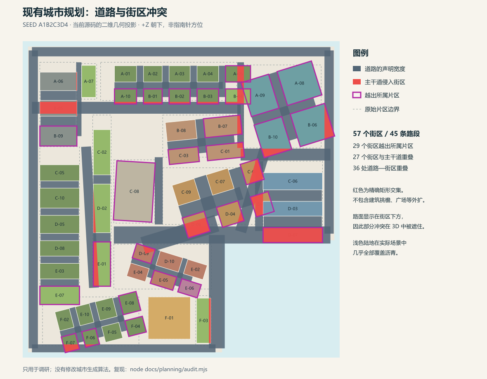

# 像素湾城市规划调研与改进方案

调研日期：2026-10-24。范围：当前工作区的城市结构、道路、街区、建筑落位和交通路径。此轮仅新增调研材料，未修改应用源码。

> 后续进展（同日）：城市已按本文建议重写为**全正交地块 + 固定主骨架 + 片区网格**的规划，见 [rectilinear-plan-2026-10-24.md](./rectilinear-plan-2026-10-24.md)。本文保留作为改版前的调研记录；`audit.mjs` 仍可对当前规划做独立校验。

## 结论与建议

当前的杂乱由两类问题叠加：**街区生成存在确定的几何错误；增加多样性时，又缺少跨片区的道路和边界约束。** 因而继续调旋转角度、随机数或增加模型，都不能稳定解决问题。

建议保留海湾、功能分区、现有建筑资产和种子复现能力，将规划改为“主路骨架固定、片区肌理受控变化、建筑服从地块”的混合方案。先做二维规划和简单体块，待结构通过检查，再接回详细建筑。第一版不必引入完整的城市生长模拟或张量场算法。

## 1. 当前项目怎样生成城市

| 层次 | 当前实现 | 判断 |
| --- | --- | --- |
| 入口与复现 | `src/main.js` 读取 URL / 本地存储的 seed，调用 `createCity` | 已有可用的复现入口，应保留 |
| 规划 | `src/city-plan.js` 的 `createCityPlan` | 已从渲染中分出，适合作为改造入口 |
| 地形 | 两个矩形拼成 L 形陆地，右下为矩形海湾 | 是可用的城市大轮廓，无须先改海岸 |
| 片区 | 14 个硬编码矩形 zone；设置行列数、间距、角度、密度、形态 | 有功能分区意图，但边界与道路缺乏共同来源 |
| 街区 | 每个 zone 内随机分配行列宽度，再旋转整组街区；当前为 57 块 | 多样性主要来自尺寸扰动和片区整体旋转 |
| 道路 | 30 条片区内部路段，加 15 条手写主干／沿岸路段 | 路段直接合并，没有路口、接驳或连通校验 |
| 建筑 | `src/city.js` 的 `planBlockLots`、`pickBuildingDef` 和各模型生成器 | 有联排、塔楼、校园、仓储等模板，但缺统一占地校验 |
| 交通 | 车辆沿街区外扩矩形环线行驶 | 是视觉动画，尚未依赖实际道路网络 |

仓库只有一个可见提交 `654c5b0`。该提交中是 5×5 网格、6 条横纵道路线、等尺寸街区；当前规划模块尚未纳入版本控制。因此可以对比“已提交网格方案”和“当前工作区方案”，无法从提交历史还原中间每次调整。

调研期间，`city.js`、`object-catalog.js`、`showcase-models.js` 仍被外部修改。核心规划文件 `city-plan.js` 在本轮检查期间保持不变；复现实验读取的源码 SHA-256 记录在 `audit-results.json`。原有临时截图只作为视觉参考，不作为最新运行结果的逐项凭证。

## 2. 检查结果

使用固定种子 `A1B2C3D4`，另外抽查 64 个确定种子。检查直接运行当前规划模块，以旋转矩形的多边形交集计算重叠，面积小于等于 0.01 的结果忽略。

| 指标 | 固定种子 | 另外 64 个种子 |
| --- | ---: | --- |
| 街区数 | 57 | 均为 57 |
| 越出所属 zone 的街区 | 29 | 28–30，全部种子出现 |
| 越出陆地的街区 | 1 | 每个种子均为 1 |
| 街区之间重叠 | 4 对 | 3–4 对，全部种子出现 |
| 主干道范围与街区重叠 | 36 处，涉及 27 块 | 35–37 处，每个种子均涉及 27 块 |

这里的“街区”包含其地面与人行道；道路重叠是声明道路宽度的矩形范围与街区地面相交，不等于已证明每处都撞到建筑实体。但足以证明规划层没有正确预留道路空间。

固定种子的 45 条声明道路，在允许交叉点连通、中心线吸附容差为 0.25 的情况下仍分成 **19 个连通分量**；按有限宽路面矩形是否有正面积交集，则为 **16 个分量**。两项均未考虑街区对路面的遮挡，也未把整岛沥青底板算作道路；因此它们表明的是“声明路段没有组成统一网络”，不是实际画面中有 19 块完全无法通行的沥青。



图中红色为主干道与街区的几何交集，紫色框表示街区越出所属片区，虚线为 zone 原始边界。图面使用世界坐标，+Z 朝下。

## 3. 杂乱的具体来源

### 3.1 街区整体偏移：应最先修复的计算错误

位置：`city-plan.js` 的 `layoutZone`，约第 316–392 行。

代码先计算：

```text
innerDepth = 可分给街区的总进深（已扣除行间道路）× fitScale
起点 localZ = -innerDepth / 2
每一行之后：localZ += 行进深 + 道路间距
```

但整组实际占用的长度是 `innerDepth + street × (rows - 1)`。使用前一个量居中，会让整组向本地 +Z 偏移 `street × (rows - 1) / 2`；X 方向同理。

两个可以直接复核的例子：

- `resA` 为 6 行、间距 1.1，整组偏移 2.75。其末端到达 z=15.95，原 zone 只到 z=13.2；即使该片区完全没有旋转，也会越界。
- `port` 为 3 行、间距 1.75，整组偏移 1.75。末端到达 z=6.55，海湾从 z=6.2 开始，因此有面积 3.15 的街区伸入海湾。该现象不依赖随机种子。

此外，`fitScale` 用扣除了道路间距的宽深去估算旋转包围盒，遗漏完整街网占用范围，并额外乘了 1.1；这不能保证旋转后的街区仍在 zone 内。文件虽然定义了 `cornersInside`，实际没有调用。道路做了裁剪，街区没有做相同的边界处理，两者因而可能进一步错位。

结论：修复居中是必要步骤，但还要用**包含道路间距的整体边界**计算旋转可容纳空间，并校验每个最终街区。只把所有角度改小，仍会保留未旋转片区的偏移错误。

### 3.2 独立画主路、独立摆街区，两者缺少空间约束

位置：`city-plan.js` 的 `ARTERIALS`、`layoutZone` 和 `createCityPlan`。

主路由手写端点决定，片区由另一组手写矩形决定。生成时把两类内部道路和主路数组直接拼接，没有“预留道路走廊后再切地块”的过程。于是斜向大道穿过矩形街区、港区压到滨水主路、不同片区互相侵入都可以正常输出。

片区道路终点被限制在各自范围内，未延伸至相邻道路，也未生成共享的交叉点节点。道路交叉只在渲染斑马线时临时计算，而且只处理部分主路交叉，不能替代规划中的拓扑结构。

### 3.3 整岛沥青把未规划空隙变成了“超宽道路”

位置：`city.js` 的 `addIsland`，约第 1099 行；`addRoads`，约第 1325 行。

几乎整片陆地上方都铺了沥青。多数道路只画标线、边线、中央绿化；路宽没有形成真正独立的道路面。街区覆盖后剩下的区域，不论有没有被规划为道路，都会呈现道路颜色。

旋转街区为适应轴对齐矩形而收缩，四周产生楔形或宽大空地；这些空地随后显得像无明确边界的停车场、交叉口和宽马路。当前街区矩形面积之和约 767.4，陆地面积约 1864.0，前者仅为后者的 41.2%。这不是精确的道路面积比例，但说明剩余空间的表达对整体观感有很大影响。

### 3.4 增加了朝向数量，没有建立朝向之间的关系

目前中心区约 +17.2°、老城约 -17.2°、商业区约 +5.7°、市政区约 -3.4°、校园约 +17.2°、郊区约 +14.3°。这些角度没有通过共同大道、历史街道或海岸方向组织，也没有给片区交界处配置过渡地块。

结果是同一张小地图上出现多套独立网格。老城、校园、中心区的功能差异是有价值的，但不需要各自再拥有一套无接驳的旋转网格。

### 3.5 建筑的占地和体量没有完全服从规划

位置：`city.js` 的 `planBlockLots`、`addCatalogBuilding`、`addSkyscraperBlock`、`addSkyscraperPlaza`。

- 普通建筑通常限制宽深，但生成 lot 时没有统一的矩形相交检测；校园组合、围合街区侧边补房、塔楼附属房都依赖局部经验条件。独立运行现有 lot 模板也能产生重叠的预约范围；这属于需要检查的候选冲突，不应直接视作最终模型穿模。
- 摩天楼主体允许使用 `lot.w + 1.0`、`lot.d + 0.6`，广场还会继续放大，规划阶段却没有为整个广场预留对应面积。建筑主体、广场、挑出部分缺少统一的占地契约。
- 摩天楼 `rise` 独立随机取值，没有应用普通楼宇使用的片区密度。因而代码中虽然有中心密度衰减，最高建筑并不真正服从同一套高度控制。
- 车辆沿街区外扩环线运动，没有验证是否属于道路面；旋转后更容易暴露交通与路网不一致的问题。

其中“中心高楼在画面上过于集中、遮挡老城和水岸”属于美术判断；道路与街区重叠、占地允许外扩则是可以直接验证的程序问题。两类问题应分别处理。

## 4. 推荐的城市结构

目标是一座**骨架清晰、局部有历史感的港湾小城**。以下角度、比例和体量均为首轮美术调参起点，不是现实城市规划规范。

### 总体骨架

保留 L 形陆地与海湾，先固定外缘通路、滨水大道、连接铁路站点与城市中心的主轴，再保留一条确实连接市政节点和海湾节点的斜向大道。所有主路交会处必须成为共享路口；斜道穿过的区域由道路重新切地，而不是压在旧矩形街区上。

第一版让约 70%–80% 的路段长度沿统一的主方向组织。差异主要由街区大小、街距、路级、庭院、广场、用途和建筑高度产生；只让少数有明确理由的片区改变主方向。

### 片区关系

| 片区 | 建议形态 | 与周边的关系 |
| --- | --- | --- |
| 中心商务区 | 统一主网格，少量较大街区，1 个主地标和次级塔楼 | 背后接中层商业过渡，保留面向海湾的视线通道 |
| 老城／创意区 | 细密短街、窄面宽建筑，可采用一组约 10°–15° 的次方向 | 至少两个接入主路的出入口，交界三角地安排广场或绿地 |
| 商业与市政区 | 以主轴和公共广场组织，延续周边路网 | 形成老城到商务区的连续过渡 |
| 住宅区 | 有长短变化的矩形街区、联排与庭院，少量错位 T 字路口 | 可混入街角小店、邻里公园，避免独立旋转整片住宅 |
| 校园 | 主路接入的完整大地块，内部步行庭院 | 首版沿统一主方向；差异来自院落与绿化，不再额外旋转 |
| 港区／工业区 | 顺岸仓储与装卸院，靠铁路设置工业通道 | 对接一条连续货运主路，明确步行滨水空间与作业空间 |
| 公园与滨水 | 连续步行带＋若干口袋公园 | 承接异形余地，给路网和不同肌理之间留出过渡 |

不必立即删除 14 个 zone；可以保留为子片区，但共享较少的宏观道路方向和连接规则。

### 天际线与建筑

先用体块确立“低层—中层—高层—地标”的序列，再选择具体模型。限制最高塔楼数量和相邻高塔组合；为主地标预留完整广场，保证相邻道路和街区可读。用俯视、默认等距、默认透视三个角度一起检查。

建筑适配失败时，先换类型、缩小组合或留作开放空间。确需合并地块时，回到地块层重新规划；不允许渲染器自行把建筑放到道路上。广场、台阶和低层附属体算入地面占地；高处挑出部分另设允许范围和净空规则。

## 5. 技术改造路线

### 阶段一：修复错误并建立可比较基线

1. 记录固定种子及源码快照；保留当前方案用于前后对照。
2. 修复 `layoutZone` 的整体居中、旋转容纳计算和街区边界校验。街区和道路使用同一组局部坐标边界。
3. 将核心主路走廊设为禁止建造范围。冲突区域要重新切分或改作广场，不能仅把冲突街区删除后留下沥青空洞。
4. 规划预览只显示陆地、道路、街区、地块、功能颜色和冲突标记；同时用基础体块核对高度。

交付：可复现的二维图与简单体块，越陆地和街区互相重叠清零，主路预留范围明确。此阶段不宣称已经完成路网重建。

### 阶段二：让道路与街区来自同一张规划图

建议拆为纯数据模块，路径仅表示建议，尚未创建：

```text
city-plan.js              对外总入口，保持易于接入现有 createCity
planning/masterplan.js    海岸、宏观片区、主路骨架与公共节点
planning/road-network.js  节点／边、相交切分、吸附、路级和通行属性
planning/blocks.js        道路走廊扣除后提取街区、剔除或合并碎片
planning/parcels.js       临街边、退界、地块划分、可建造范围
planning/validate.js      几何与连通性检查、结构化诊断
```

推荐的生成依赖是：

```text
地形与功能意图 → 主路骨架 → 带接驳的片区支路
             → 完整道路走廊 → 街区 → 临街地块 → 建筑体量与模型
```

最小路网数据应有稳定的 node/edge ID、共享节点、道路宽度、等级和通行属性；街区保存多边形与相邻道路，地块保存临街边、朝向和可建造范围。片区先表达用途与方向意图，最终边界由路网和地形裁定。

主路固定后，在片区内生成受控格网，将端点吸附或延伸至指定出入口；相交处切边。小于最小夹角／长度的岔路合并；明确标注少量允许的尽端路。对斜路产生的三角形、小狭长片，优先用广场、绿地或合并处理。

几何实现需支持道路带的并集、陆地差集、多连通区域和孔洞。可以采用二维多边形布尔运算；第一版也可先在主路切出的多边形内放入合规矩形，再显式分配剩余开放空间。两种方式均需让最终路面、街区与校验共享同一份几何，避免出现第二套手写坐标。建筑暂时继续用矩形地块，不必为所有异形边界重写模型。

交付：主路单一连通网络、各片区有明确接入、可用于后续交通的道路数据。

### 阶段三：把有序的多样性与详细模型接回来

1. 增加可单独控制的街区尺寸、长宽比、临街面宽、院落比例、道路间距与少量网格错位。
2. 老城采用一个次方向并处理过渡边界；不要恢复每个 zone 独立旋转的方式。
3. 模型声明 `groundFootprint`、`preferredLotSize`、高度范围、入口方向；检测最终旋转和装饰后的占用。
4. 高塔及广场作为一组规划对象，统一预留，不用 `lot + 常量` 突破占地限制。
5. 车辆路径从通行道路与路口生成。第一版即使仍是短环线，也应沿合法道路边构造。
6. 规划、地块、建筑、装饰、交通分开使用派生随机流，例如按 `seed + 稳定片区/地块 ID + 子系统名` 派生，避免增加一个模型的随机调用改变后续整城。

现有的渲染器、物体目录、昼夜环境、相机、种子 UI 和大部分建筑生成器可继续使用。改造重点放在规划数据与模型落位接口。

## 6. 验收条件

| 类型 | 首版应满足 |
| --- | --- |
| 陆地 | 所有普通街区和建筑地面占地在陆地内；码头等水上对象单独声明 |
| 空间 | 街区之间、独立建筑之间无未声明重叠；可建造范围避开道路与公共空间 |
| 路网 | 所有车行主路属于同一连通网络；片区支路可到达该网络；有意尽端路显式标记 |
| 临街 | 建筑具有可达的临街入口；校园等内部建筑允许通过步行路径接入 |
| 交通 | 车辆采样位置与车身宽度落在可通行路面内；路口转向有合法连接 |
| 复现 | 固定版本、配置和 seed 输出一致；增加装饰不改变主路骨架 |
| 观感 | 关闭模型细节后仍能读出主路、中心、老城和港区；没有用途不明的大片沥青 |
| 回归 | 固定种子 A1B2C3D4 加多种子批量检查；同角度截图对照，分别查看规划图和最终场景 |

几何检查可先采用 1e-6 的容差，并按场景单位调整；面积阈值、吸附距离、最小街区面积应成为显式参数。自动检查守住结构底线，截图评审负责最终构图。

## 7. 参考与本项目的取舍

[Interactive Procedural Street Modeling，Chen 等，SIGGRAPH 2008](https://www.sci.utah.edu/~chengu/street_sig08/street_project.htm) 将方向场设计、道路图生成和三维几何生成分为相继阶段，并支持全局与局部控制。这支持“先控制路网、再生成几何”的方向。

对当前只有 57 个街区的项目，我建议借鉴其分层与控制思路，先采用手工骨架加受约束的片区生成。完整方向场、任意曲线路网或城市生长模拟可在结构稳定后再评估；这属于针对当前代码规模的工程取舍，并非该论文的原结论。

## 8. 复现与本轮验证边界

在项目根目录运行：

```powershell
node docs/planning/audit.mjs
npm.cmd run build
```

审计脚本读取应用源码，输出 `audit-results.json` 和 `current-layout-audit.svg`。PNG 是 SVG 的渲染副本。脚本不修复、不改写应用源码，也不以发现已有问题作为进程失败条件。

`npm.cmd run build` 已通过，存在已有的包体积提示。另用最小 Canvas 桩在 Node 中实例化了固定种子的 Three.js 城市，能够完成场景构建；该检查不包含 WebGL 绘制。浏览器工具访问本机开发地址超时，所以没有把此次工作表述为完成了新的浏览器视觉回归。

本轮新增的文件均在 `docs/planning/`；原有未提交修改和临时文件未做清理或提交。
