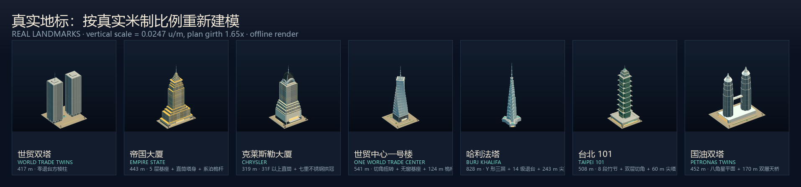
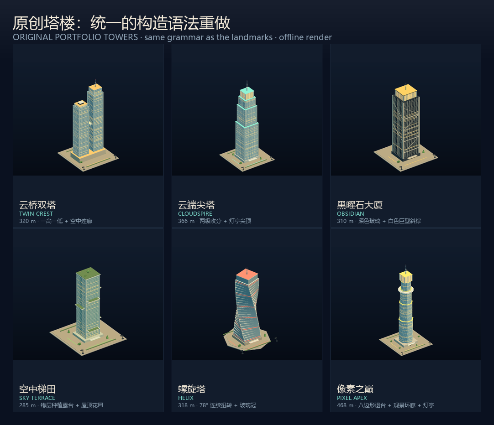

# 摩天大楼重制说明 · SKYSCRAPER REBUILD

图鉴「摩天大楼」分组的 13 件模型按真实建筑重新建模。真实地标以公开的
建筑高度 / 体量分段 / 平面数据为准；6 座原创塔楼沿用同一套构造语法重做。





## 1. 旧模型的问题

- 所有塔楼的高度都取自同一个随机区间（9.4–10.6 格），`model.rise` 数据完全没被读取，
  于是 828 m 的哈利法塔和 319 m 的克莱斯勒一样高，「天际线比例」是假的。
- 每个「风格」只是把方盒子一层层缩小：没有真实的退台节奏、塔冠、平面形状与立面材质，
  帝国大厦、克莱斯勒、世贸双塔在缩略图上几乎可以互换。
- 世界贸易中心双塔被做成了带裙房的收分塔（真实建筑是零退台纯棱柱）；
  克莱斯勒的塔冠只占很小比例（真实塔冠 + 尖针约占总高 30%）。

## 2. 建模方法

### 2.1 统一的真实尺度

```js
const TOWER_METRE = 0.0247; // 每真实米对应 0.0247 体素单位（828 m → 20.4 格）
const tw = (m) => m * TOWER_METRE * 1.65; // 平面尺寸：加 1.65 倍「体量补偿」
const th = (m) => m * TOWER_METRE;        // 高度：真实米制，不做补偿
```

- 高度统一按真实米制换算，所以**建筑之间的相对高度是真实的**：
  哈利法塔 20.5 格、世贸一号楼 13.4、台北 101 12.5、国油双塔 11.2、
  帝国大厦 10.9、世贸双塔 10.3、克莱斯勒 7.9。
- 平面加 1.65 倍补偿：若严格按 1:1，图上塔身只有 2–3 像素宽，塔冠与立面节奏全部丢失。
  补偿只作用于水平方向，因此细长比排序与真实一致（哈利法塔最瘦、世贸双塔最敦实）。
- 每座楼的分段表（楼层标高、各段宽度比例、塔冠高度）来自 `reference-*.md`，
  代码里用米制常量书写，便于对照与复核。

### 2.2 每座地标的建模要点

| 图鉴条目 | 真实高度 | 重做的关键体量 |
| --- | --- | --- |
| `s-trade` 世贸双塔 | 417 m | 63.4 m 见方、全高零退台、抬升广场；铝包钢密柱 + 窄窗形成的纯竖向条纹；底部三叉柱尖拱；北塔 110 m 天线；广场铜球 |
| `s-empire` 帝国大厦 | 443 m | 5 层基座占满 129.5×57 m 地块（最大退台在 5F）；30–72F 笔直塔身；86F 外挑开放观景台；六级塔冠 + 八角系泊桅杆 + 62 m 天线 |
| `s-chrysler` 克莱斯勒 | 319 m | 底部 16F 大体块 + 四级退台；31F 以上 40 m 宽直筒；七重嵌套不锈钢拱冠（四面均为同心拱 + 三角窗）；45 m 尖针；塔冠 + 尖针约占总高 30% |
| `s-onewtc` 世贸一号楼 | 541 m | 57 m 高无窗金属基座；方形平面向上旋转 45° 的切角玻璃体（14 段）；417 m 女儿墙平台；124 m 桅杆与环形平台 |
| `s-burj` 哈利法塔 | 828 m | Y 形三翼平面 + 14 级螺旋退台（翼端错高）；585 m 处近水平顶面；243 m 近乎笔直的尖顶（占总高 29%）；2.4 倍塔宽的 Y 形裙房与水池庭院 |
| `s-taipei` 台北 101 | 508 m | 96 m 宽商场裙房；8 段 × 45 m 竹节（每段顶部外张 + 飞檐 + 如意转角）；406 m 处收成 0.62 倍小塔；60 m 尖塔与装饰环 |
| `s-petronas` 国油双塔 | 452 m | 八角星（Rub el Hizb）平面：八边形核心 + 8 个星叶 + 8 条竖向不锈钢脊；L60/L73/L84 三级收分；170 m 处双层天桥 + 拱形斜腿；阶梯冠 + 47 m 分段尖顶；两塔等高 |

### 2.3 原创塔楼

`twincrest`、`cloudspire`、`obsidian`、`terrace`、`helix`、`apex` 保留原有的设定与配色，
但改用同一套「基座 → 塔身 → 退台/露台 → 塔冠 → 尖顶」构造语法重做；
高度改为读取 `model.tall` 的真实米数，平面尺寸写入 `model.plan`。

## 3. 验证方式

沙箱禁止 Chromium 的命名管道 IPC，无法用无头浏览器截图，因此做了两层离线验证：

1. **离线软光栅渲染器** `render.mjs`：直接在 Node 里构建与图鉴完全相同的
   `createShowcaseModel` 场景图，用正交相机 + 简单的方向光做三角形光栅化，
   输出与图鉴同视角（3/4 正交）的 PNG。用于检查轮廓、退台与塔冠比例。
2. **盲测识别**：把渲染图匿名化后交给具备视觉能力的模型，只问「这是什么建筑」，
   不提供候选答案。同一模型在改造前后的识别置信度（0–1，单次采样有 ±0.2 左右波动）：

| 条目 | 旧模型 | 重制后（多轮盲测） |
| --- | --- | --- |
| 世贸双塔 | 0.55 | 0.72 |
| 帝国大厦 | 0.12 | 0.72 |
| 克莱斯勒 | 0.45 | 0.86 |
| 世贸一号楼 | 0.60 | 0.78 |
| 哈利法塔 | 0.50 | 0.80 |
| 台北 101 | 0.55 | 0.86 / 0.42（波动大，见下） |
| 国油双塔 | 0.15 | 0.55–0.78 |

台北 101 的盲测波动最大：结构特征（8 段竹节）在 4:3 卡片上只有十几像素高，
不同采样会被读成「台北 101」「金茂」「Al Hamra」或「原创宝塔塔」。这是缩略图尺度的
信息上限，不是建模错误。

改造前的对照见 `sheet-before.png`。

## 4. 已知限制

- **颜色**：离线渲染器只是近似（用漫反射近似 PBR，没有环境贴图与色调映射），
  所以复查图里的颜色比图鉴实际 WebGL 渲染更暗、更偏青。真实配色以
  `object-catalog.js` 里的 `glass / mullion / walls / accent` 为准，已按参考报告改过一轮
  （石灰岩、深色窗、银灰竖梃、绿色玻璃等）。
- **金属度**：图鉴没有环境贴图，金属度过高的材质在真实渲染里会发黑，
  因此 `towerMaterials` 把金属度控制在 0.04–0.4。
- **城市天际线**：`src/city.js` 里另有一份独立的摩天楼几何（`addSkyscraperBlock`），
  本次没有改动，城市里的塔楼仍是旧写法；本次只重做了图鉴（`showcase-models.js`）。
  如需同步，可把 `TOWER_BUILDERS` 里的分段逻辑移植过去。
- **参考照片**：本次运行环境访问 Wikimedia 失败，没有下载到参考照片，
  调研改以文字资料（CTBUH、摩天楼博物馆、官方资料等）为准，来源见两份参考报告。
- 墙面边长、退台段宽等部分数据在公开资料中缺失，报告里标注为「推算」，误差约 ±10–15%。

## 5. 文件

| 文件 | 说明 |
| --- | --- |
| `src/showcase-models.js` | 新的 `buildSkyscraper` + 13 个塔楼 builder + 尺度/材质/立面工具 |
| `src/object-catalog.js` | 摩天大楼配色、`plan` 尺寸与两处文案更新 |
| `docs/skyscrapers/reference-us-deco.md` | 美国四座地标的体量 / 退台 / 外观调研（含来源） |
| `docs/skyscrapers/reference-asia-supertall.md` | 亚洲三座超高层的体量 / 收分 / 平面调研（含来源） |
| `docs/skyscrapers/render.mjs` | 离线渲染 + 轮廓 ASCII + 配色统计工具 |
| `docs/skyscrapers/compose.py` | 拼合带标签的对照图（Pillow） |
| `docs/skyscrapers/study.html` / `study.js` | 浏览器内的对照页（走图鉴同一个 `ShowcaseStudio`） |
| `docs/skyscrapers/before/` · `after/` · `after-card/` | 旧模型 / 新模型（竖版 420×760）/ 新模型（卡片比例 480×360） |

## 6. 复现

```bash
# 渲染全部摩天大楼（卡片比例）
node docs/skyscrapers/render.mjs --out docs/skyscrapers/after-card --w 480 --h 360

# 只看某几座，并打印 ASCII 轮廓 + 主色统计
node docs/skyscrapers/render.mjs --ids s-burj,s-chrysler --ascii --silhouette --stats

# 拼合对照图
<bundled-python> docs/skyscrapers/compose.py
```
