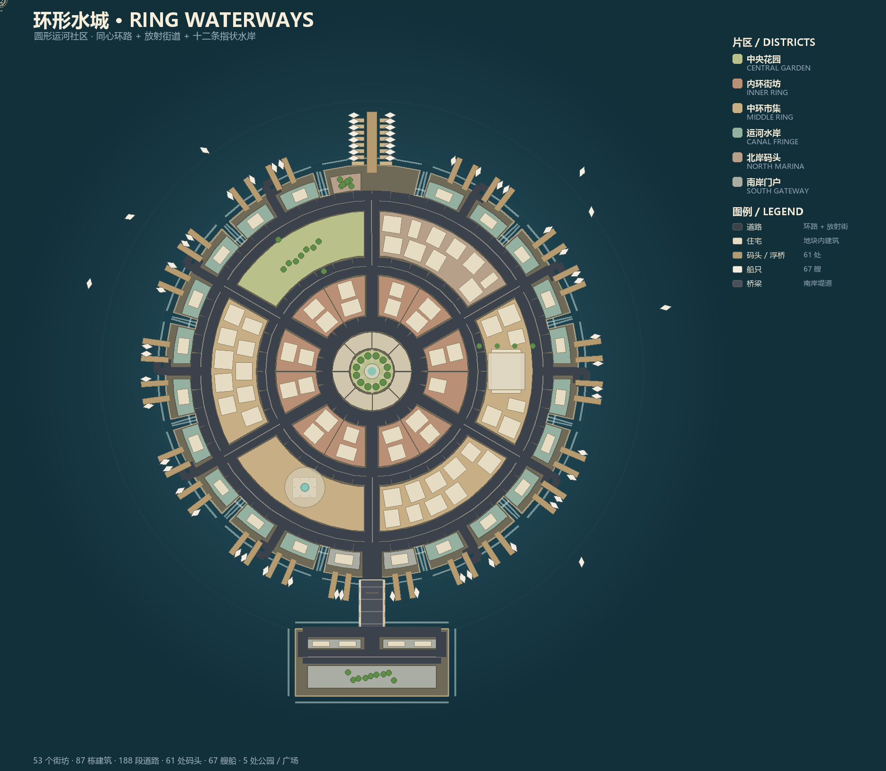

# 环形水城 · RING WATERWAYS

`ring-study/` 是像素湾的第二张地图：一个**圆形运河社区**。独立入口、独立路网与地块生成，
不改动原版 `index.html` / `src/city.js` / `src/city-plan.js`，也不影响图鉴和提案 02。

参考图是一张真实的圆形运河社区航拍：中央花园 + 环形道路 + 放射街道 +
一圈圈临水住宅 + 外侧手指状码头 + 北岸游艇码头 + 南侧唯一堤道。



## 运行

```powershell
# 与提案 02 相同的独立服务器方式（端口 5190）
node node_modules/vite/bin/vite.js --config ring-study/vite.config.mjs
```

- 新地图：`http://127.0.0.1:5190/ring-study/`
- 同一服务器下的 `/`（原版像素湾）与 `/catalog.html`（图鉴）仍可访问
- 视角：城市 / 分区 / 路网三个按钮、昼夜环境、种子面板、建筑档案、模拟控制都沿用原版控件

构建与验证：

```powershell
node ring-study/verify.mjs
node node_modules/vite/bin/vite.js build --config ring-study/vite.config.mjs
```

产物输出到 `dist-ring-study/`。若当前环境限制了配置文件的子进程加载（沙箱下 Vite 的
config bundler 会 spawn 失败），可以直接用程序化构建：

```powershell
node --input-type=module -e "import { build } from 'vite'; await build({ configFile: false, root: 'D:/workspace/voxel-city', build: { outDir: 'dist-ring-study', emptyOutDir: true, rollupOptions: { input: { ring: 'D:/workspace/voxel-city/ring-study/index.html', original: 'D:/workspace/voxel-city/index.html', catalog: 'D:/workspace/voxel-city/catalog.html' } } } });"
```

## 参考图 → 地图的对应关系

| 参考照片特征 | 地图实现 |
| --- | --- |
| 正中的圆形绿地（环岛、放射小径、纪念物） | 半径 1.75 的中央花园 + 外圈 1.45 宽的环岛广场（8 个铺装扇区、长椅），六条园路放射接入 |
| 环绕绿地的第一条环形道路 | 内环 `ringA`（r=3.9，宽 1.2） |
| 一圈朝内、小而密的住宅 | 内环街坊 `I0–I11`：12 个 30° 扇形，每个 2 排 × 2 栋 |
| 第二条环形主路 | 中环 `ringB`（r=8.6，宽 1.4） |
| 第二圈更大的住宅、一条主路、少量放射连接 | 中环 6 个 60° 扇区：南门/西门市集、南岸广场、西环公园、码头事务所、环湾之塔 |
| 外围指状半岛与运河 | 12 条 27° 手指，之间 3° 运河水道，切到第三条环路 |
| 几乎每户都有私家码头、水里有船 | 每条水岸手指 4 个木码头 + 每个码头 1 艘船；57 艘船 |
| 北侧游艇码头与浮桥 | 北岸码头 `F9`：一条 5 单位长的主栈桥 + 每侧 8 条横向浮桥 |
| 南侧唯一的陆路联系 | 南岸堤道 + 跨水桥（栏杆、桥墩、引道），桥头南北两片门房街坊 |
| 整体是连续的环，不是一堆孤岛 | 齿轮状陆地由三条环路串起，所有街区都落在同一块陆地上 |

## 几何常量

全部集中在 `plan.js` 的 `MAP` 里（单位与主项目一致：X 向东、Z 向南）：

| 常量 | 值 | 含义 |
| --- | --- | --- |
| `parkRadius` | 3.15 | 中央花园半径 |
| `ringA / ringB / ringC` | 3.9 / 8.6 / 13.9 | 三条环路的中心线半径 |
| `innerIn…innerOut` | 4.55 – 7.8 | 内环街坊的径向范围 |
| `midIn…midOut` | 9.4 – 13.05 | 中环扇区的径向范围 |
| `outerIn / tip` | 14.75 / 18.7 | 水岸手指的起点与最外缘 |
| `fingers / fingerHalf` | 12 / 13.5° | 手指数量与半角（运河宽 3°） |
| `mainland` | x −6.2…6.2，z 20.95…24.6 | 南岸主陆与桥头 |

环路的顶点数取 24 / 36 / 60，都能被 6° 整除，所以放射路与园路的端点一定落在环路节点上，
路网不会被拆成孤立的连通块；每条手指的支路以一个小回环收尾，没有断头路。

## 文件

| 文件 | 作用 |
| --- | --- |
| `plan.js` | 圆形地图生成器：陆地图层、三条环路、放射路、手指支路与回环、扇区街区、弧线排布的住宅、码头、船只、路网图与自检 |
| `city.js` | 三维装配：陆地块挤出、岸墙与浪花、道路、街区、按片区铺面、码头/船、车流、树与灯 |
| `native-buildings.js` | 从主项目复制，按地块生成精细建筑模型 |
| `water.js` | 从主项目复制的海水着色器 |
| `style.css` | 视图切换条的补充样式（原版样式表之外的那一小块） |
| `main.js` | 从提案 02 入口复制，改用独立 localStorage 键（`pixelbay.ringseed` / `pixelbay.ringprojection`），相机取景放宽到 ±24.5 |
| `index.html` | 独立页面（沿用原版样式表与全部控件 id） |
| `verify.mjs` | 64 个规划种子 + 5 个渲染种子 + 几何/网络/UI 断言 |
| `preview.mjs` / `preview.py` | 导出平面 JSON 并绘制 `preview-plan.png` |
| `reference-source.png` | 参考航拍图（用户提供） |

## 验证结果

`node ring-study/verify.mjs`：

- 64 个规划种子：`diagnostics.failures` 全空；路网与种子无关（只影响建筑与细节）
- 5 个渲染种子：建筑轮廓全部落在所属街区内、互不重叠、高度不超过地块、档案字段齐全
- 网络：单连通分量，无断头路
- 陆水关系：花园中心是陆地、手指之间的运河是水、外海是水、南岸桥头是陆地
- UI：镜像原版 51 个控件 id 中的 49 个（原版在本图开发期间新增了「微缩」摄影控件，独立地图未镜像），使用原版样式表
- 默认统计：88 栋建筑 / 22 辆车 / 67 艘船 / 6 个片区 / 5 处公园广场（建筑数量随种子在 75–90 之间变化）

## 已知限制

- 本图是独立入口（与提案 02 同一模式），原版地图保持原样；两套地图共用同一套建筑模型、材质与样式表。原版后来新增的「微缩」摄影效果（`src/miniature.js`）只在原版页面提供。
- 沙箱禁止 Chromium 的命名管道 IPC，无法无头截图；三维部分用 Node 侧 `createCity` 构建与断言验证，
  平面图由 `preview.py` 渲染。首次在浏览器中打开时若发现仅影响观感的细节问题，可直接调 `plan.js` 的 `MAP` 常量。
- 参考图中的建筑是随机的独栋别墅群，本图按体素风格统一为街区化排布；如需更自由的地块尺寸，
  改 `radialLots()` / `gridLots()` 的 `target` 与 `depth` 即可。
